# Airline Route Delay-Risk Analyzer

Graph machine learning on the US airline network. Airports are nodes and routes are edges. For every route, the
model predicts next month's **disruption risk class** (low / medium / high) from this month's traffic, weather and
network structure. The project includes an honest time-ordered backtest with bootstrap confidence intervals, a
next-month forecast, a Streamlit dashboard, SHAP explanations, a structural "what if a hub shuts down" tool and a
Neo4j graph database.

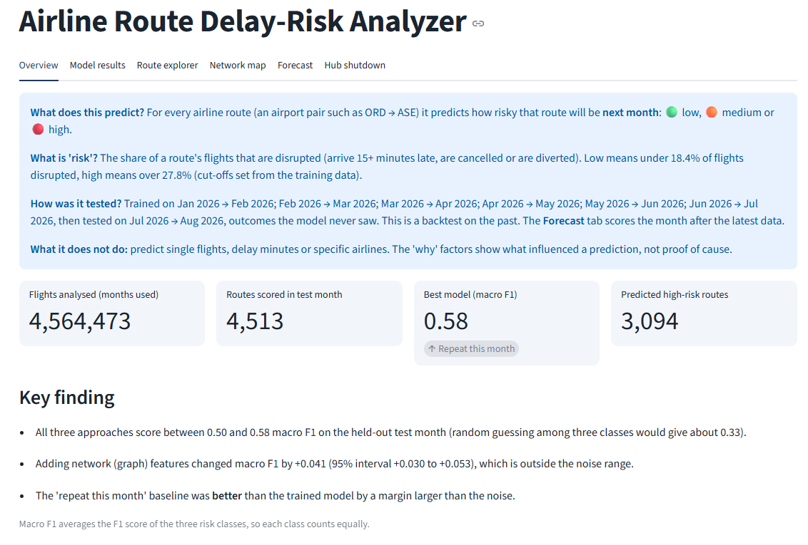

## Headline result

Trained on Jan to Jul 2026 and tested on a held-out month (Aug 2026) that the models never saw:

| Approach | Macro F1 | 95% interval |
|---|---|---|
| Repeat this month's risk (no learning) | 0.579 | 0.565 to 0.593 |
| XGBoost, no graph features (21 features) | 0.499 | 0.483 to 0.513 |
| XGBoost + graph features (51 features) | 0.540 | 0.525 to 0.555 |

Random guessing among three classes would score about 0.33.

- **The graph features helped.** Adding centrality measures and GCN embeddings raised macro F1 by +0.041
  (95% interval +0.030 to +0.053), a difference the bootstrap shows is not noise.
- **A simple baseline still wins.** Repeating this month's risk class beat both trained models by more than the
  noise (graph model minus baseline: -0.038, interval -0.053 to -0.023). Most of the signal is that a route that
  is disrupted this month tends to stay disrupted next month. This is reported as a limitation, not hidden.
- The August test month had more high-risk routes than the training months (41% against 33%), and the trained
  models over-flagged "high". See the confusion matrices below.

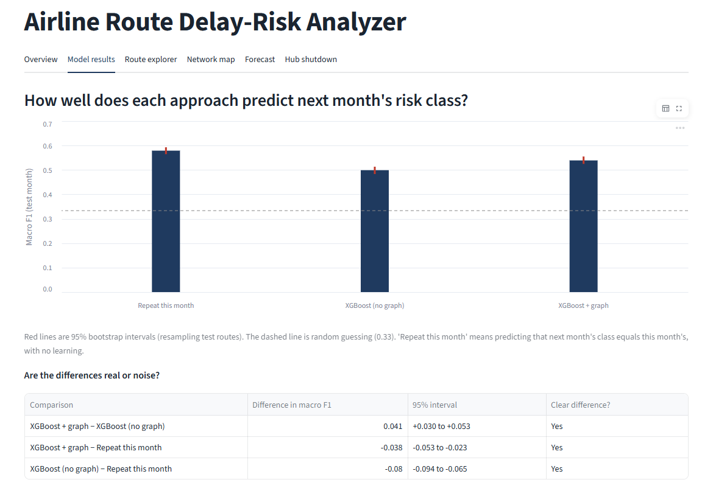

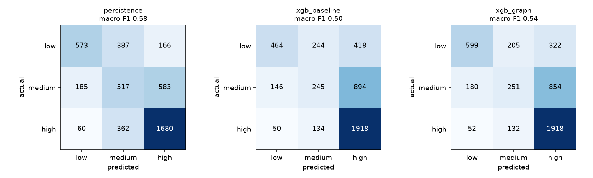

## Data

| Source | Used for |
|---|---|
| [BTS On-Time Performance](https://www.transtats.bts.gov/) (Reporting Carrier table) | 4.7 million US domestic flights, Jan to Aug 2026 |
| [OpenFlights](https://openflights.org/data.php) `airports.dat` | Airport names and coordinates |
| [Open-Meteo](https://open-meteo.com/) archive API | Daily rain and wind at the 120 busiest airports (118 downloaded) |

A flight is **disrupted** if it arrived 15 or more minutes late, was cancelled or was diverted. A route's risk is
the share of its flights that were disrupted in a month. Routes with fewer than 30 flights in a month are dropped.
Low / medium / high are the terciles of the **training** months' disruption rates (cut-offs 18.4% and 27.8%), and
the same cut-offs are applied to the test month.

## Method

1. **Graph.** Airports are nodes and routes are weighted edges (the training graph has 340 airports and 5,151
   routes). Features per airport: degree, PageRank, betweenness, clustering, dependence on a single source, and
   whether it is an articulation point.
2. **GCN embeddings.** A 2-layer graph convolutional network (PyTorch Geometric) is trained without delay labels
   on a link-prediction task, using the first month's graph only. It gives each airport an 8-number structural
   fingerprint. It reaches link-prediction AUC 0.959 on a later month's graph.
3. **Prediction.** Features from month *t* predict each route's risk class in month *t+1*. XGBoost with balanced
   sample weights. The split is **time-ordered** (train on earlier months, test on the last), so nothing from the
   future leaks into training.
4. **Evaluation.** Precision, recall and F1 per class, macro F1, confusion matrices and 95% bootstrap intervals
   (resampling test routes) for each model and for the differences between models.
5. **Explainability.** SHAP values give the top drivers for every prediction.
6. **Forecast.** The same model is trained on all month pairs and scores the latest month to predict the next
   one (Sep 2026: 4,587 routes scored, 2,215 high, 919 medium, 1,453 low). This cannot be verified until that
   month happens. The test-month results are the honest accuracy estimate.

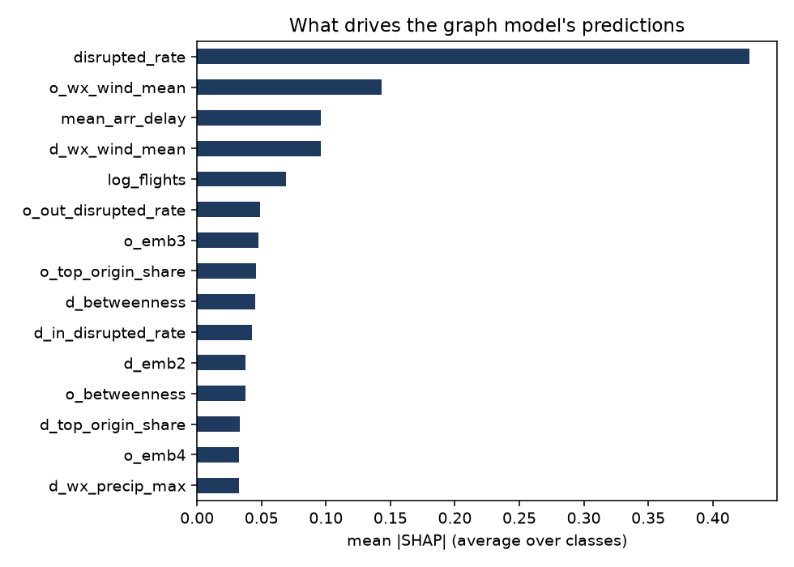

## Dashboard

Run with `streamlit run app.py`. Tabs: Overview, Model results, Route explorer, Network map, Forecast, Hub shutdown.

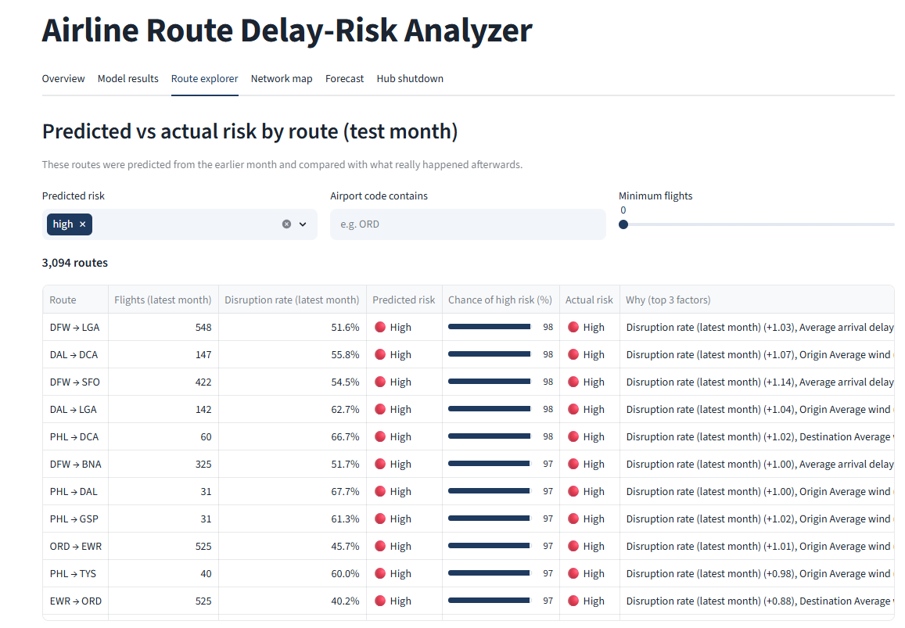
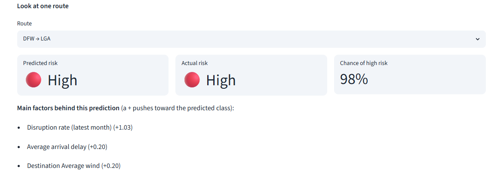
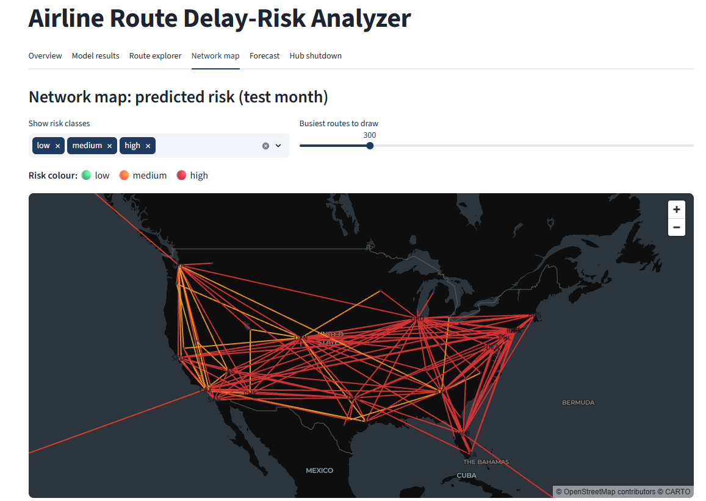
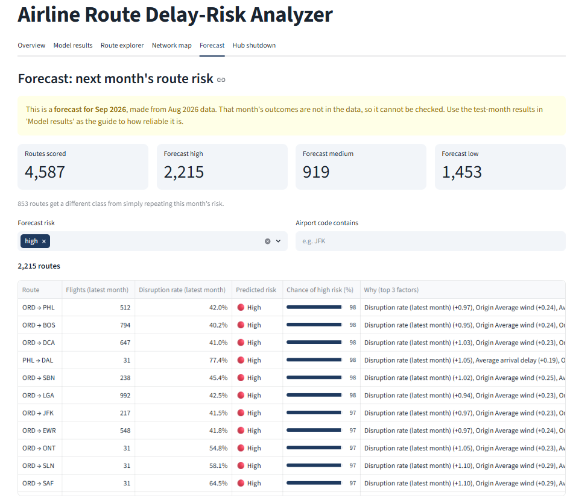

### Hub shutdown what-if

A structural analysis: remove one airport from the route network and measure lost routes and traffic, airports cut
off and longer detours. Closing Chicago O'Hare (ORD) removes 11.2% of all flights and cuts off 15 airports.
It does not model rerouting or real delay propagation.

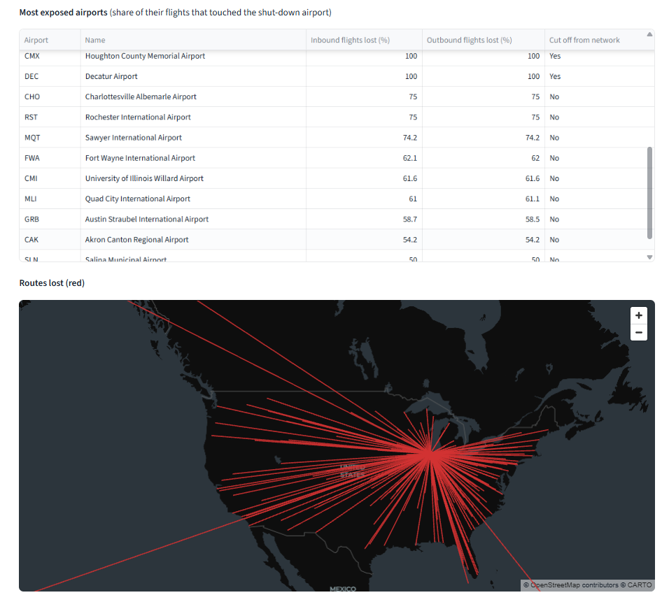
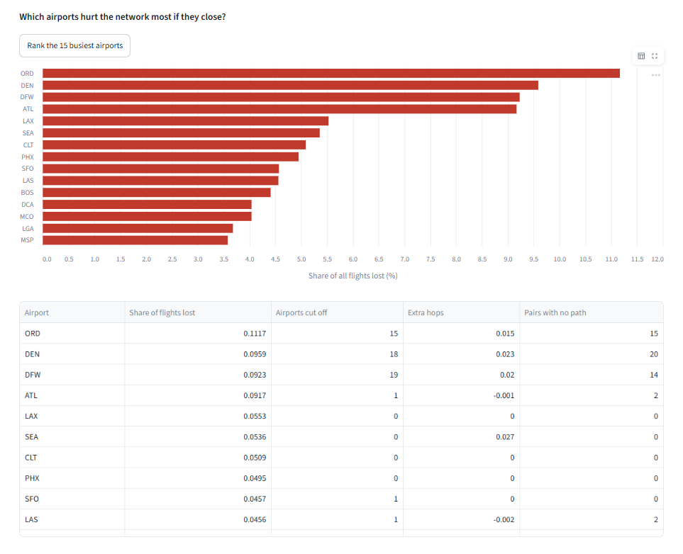

## Neo4j

The airport network is also loaded into Neo4j with each route's predicted risk, so it can be queried in Cypher:

```cypher
MATCH (o:Airport)-[r:ROUTE]->(d:Airport)
WHERE r.risk_pred = "high" AND o.out_degree > 80 AND d.out_degree > 80
RETURN o, r, d
```

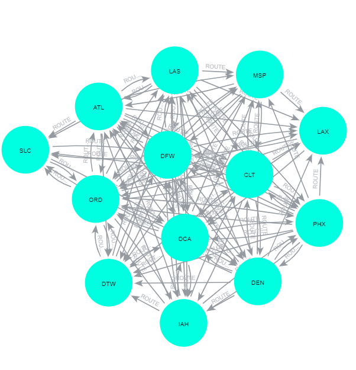

## Run it yourself

```
pip install -r requirements.txt
```
1. Download monthly BTS files (Reporting Carrier On-Time Performance, prezipped) and unzip the CSVs into
   `data/raw/bts/`. Months must be consecutive calendar months.
2. Set `TRAIN_MONTHS` and `TEST_MONTHS` in `src/config.py`.
3. `python run_all.py` (cleans data, downloads weather, builds the graph, trains, evaluates, forecasts).
4. `streamlit run app.py`
5. Optional, for Neo4j: start a local instance, then
   `NEO4J_PASSWORD=... python src/neo4j_load.py` (PowerShell: `$env:NEO4J_PASSWORD="..."`).

Data and outputs are not stored in this repository because the files are large. `run_all.py` regenerates them.
See `WALKTHROUGH.md` for a plain-language explanation of every step.

## Limitations

- Weather features come from the feature month, so they describe recent conditions, not the coming month's weather.
- Only 8 months of data and a single test month. Results for other months or seasons may differ.
- The bootstrap treats routes as independent, but routes share airports, so the intervals are somewhat optimistic.
- The hub-shutdown tool is structural only (no rerouting, rebooking or delay propagation).
- US domestic data reported by large carriers. The results do not transfer to other countries.
- The forecast cannot be checked until the forecast month has happened.

## Tech

Python, pandas, NetworkX, PyTorch Geometric (GCN), XGBoost, scikit-learn, SHAP, Streamlit, pydeck, Neo4j (Cypher).
